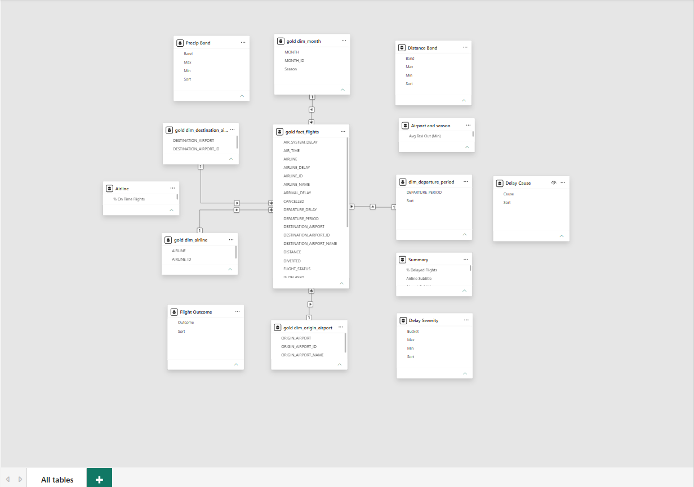
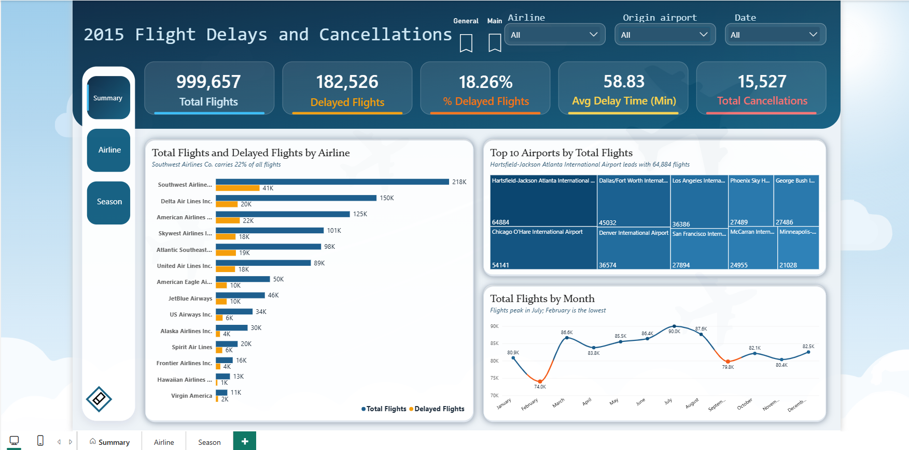
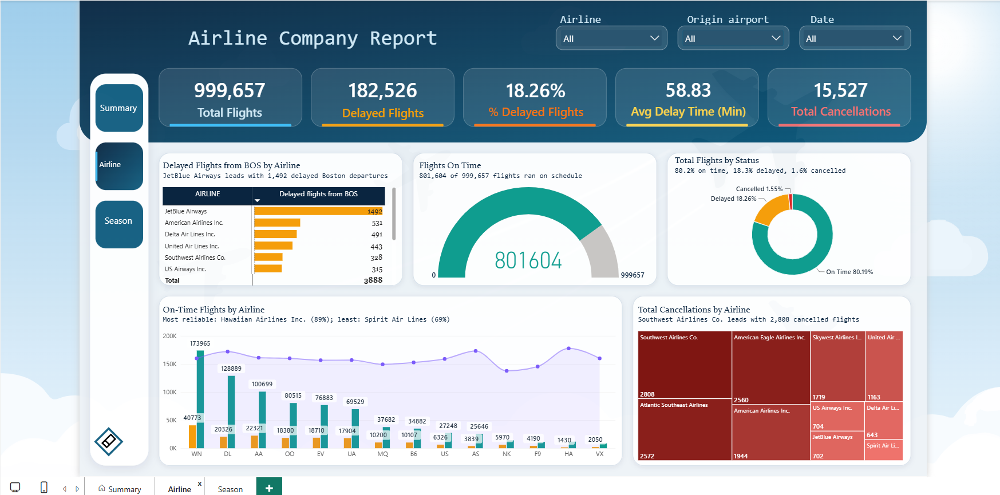
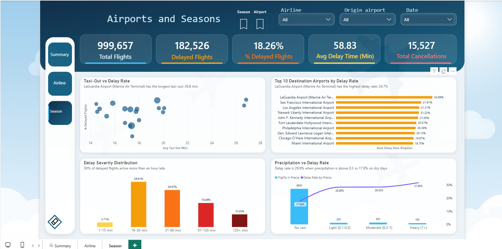
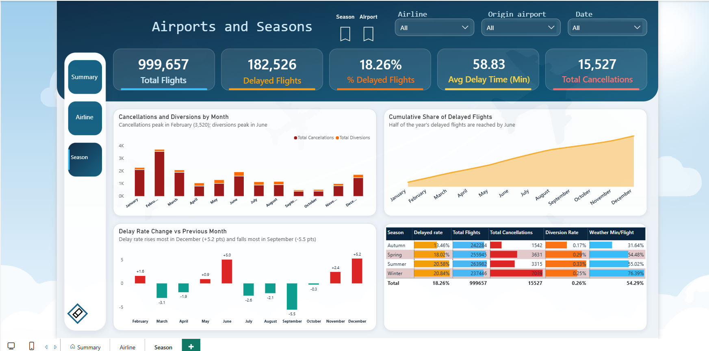

# ✈️ Flight Delay Analysis — Uçuş Gecikmələrinin Təhlili

  

## 🚀 Live Demo

Try the Flight Delay Predictor application:

**Live Application:** https://flight-delay-risk-predictor.streamlit.app/

## 📌 Layihə haqqında

Uçuşların gecikməsi sərnişinlərə, aviaşirkətlərə və hava limanlarının fəaliyyətinə təsir edən mühüm problemlərdən biridir. Gecikmələrin səbəblərini və yaranma qanunauyğunluqlarını araşdırmaq daha yaxşı planlaşdırma və qərarların qəbul edilməsinə kömək edə bilər.

**Flight Delay Analysis** ABŞ uçuş məlumatlarının təhlili, tarixi hava şəraiti məlumatları ilə zənginləşdirilməsi, statistik araşdırmaların aparılması və uçuş gecikmələrinin proqnozlaşdırılması üçün Machine Learning modellərinin hazırlanmasını əhatə edən End-to-End Data Analytics layihəsidir.

Layihə məlumatların təmizlənməsindən və SQL Server-də saxlanılmasından başlayaraq statistik təhlil, xüsusiyyətlərin yaradılması və proqnozlaşdırıcı modellərin qurulmasına qədər əsas mərhələləri əhatə edir.

## 🎯 Layihənin məqsədləri

- Aviaşirkətlər, hava limanları və həftənin günləri üzrə gecikmələri təhlil etmək.
- Hava şəraiti ilə uçuş gecikmələri arasındakı əlaqəni araşdırmaq.
- Gecikmələrlə əlaqəli əsas dəyişənləri müəyyənləşdirmək.
- Statistik testlər vasitəsilə məlumatlar arasındakı əlaqələri qiymətləndirmək.
- Machine Learning üçün yeni xüsusiyyətlər yaratmaq.
- Uçuş gecikmələrini proqnozlaşdıran təsnifat modelləri qurmaq və qiymətləndirmək.
- Analitik nəticələri vizuallaşdırmaq və Power BI vasitəsilə təqdim etmək.

📁 Layihənin strukturu
## Project Workflow

  

## 🛠️ İstifadə olunan texnologiyalar

| Texnologiya | İstifadə məqsədi |
|---|---|
| Python | Məlumatların emalı, təhlili və modelləşdirmə |
| Pandas və NumPy | Məlumatların təmizlənməsi və çevrilməsi |
| SQL Server | Məlumatların saxlanılması və idarə edilməsi |
| SQLAlchemy və pymssql | Python ilə SQL Server arasında əlaqə |
| Jupyter Notebook | Analizlərin aparılması və sənədləşdirilməsi |
| SciPy | Statistik testlər |
| Scikit-learn | Machine Learning modelləri və qiymətləndirmə |
| imbalanced-learn | SMOTE vasitəsilə sinif balanssızlığının aradan qaldırılması |
| Open-Meteo API | Tarixi hava məlumatlarının əldə edilməsi |
| Power BI | Məlumatların vizuallaşdırılması və dashboard hazırlanması |
| Git və GitHub | Versiyaların idarə edilməsi və layihənin saxlanılması |

## 📂 Məlumat mənbələri

### 1. Uçuş məlumatları

Layihədə Kaggle platformasından əldə edilmiş ABŞ uçuş məlumatlarından istifadə olunur. İlkin məlumat dəsti təxminən 5 milyon sətirdən ibarətdir.

Məlumat dəstində aşağıdakı göstəricilər mövcuddur:

- Uçuş tarixi və planlaşdırılmış vaxtlar
- Aviaşirkətlər və uçuş nömrələri
- Uçuşun başlanğıc və təyinat hava limanları
- Uçuşların yola düşmə və çatma gecikmələri
- Taxi vaxtları və uçuş müddəti
- Ləğv edilmiş və istiqaməti dəyişdirilmiş uçuşlar
- Uçuş məsafəsi

### 2. Hava şəraiti məlumatları

Tarixi hava məlumatları [Open-Meteo API](https://open-meteo.com/) vasitəsilə əldə edilir.

Hava məlumatları hava limanı, tarix və vaxt əsasında uçuş məlumatları ilə birləşdirilir. Beləliklə, külək, yağıntı və digər meteoroloji göstəriciləri təhlilə daxil etmək mümkün olur.

## 🔄 Layihənin iş mərhələləri

### 1. Data Engineering və məlumatların hazırlanması

- İlkin uçuş məlumatlarının yüklənməsi və araşdırılması.
- Python və Pandas vasitəsilə məlumatların təmizlənməsi.
- Hava limanlarının identifikatorlarının kodlar və təsviri məlumatlarla uyğunlaşdırılması.
- Təhlilə uyğun olmayan qeydlərin müvafiq mərhələlərdə çıxarılması.
- Tarixi hava məlumatlarının uçuş məlumatlarına əlavə edilməsi.
- Məlumatların SQL Server-də Bronze, Silver və Gold qatları üzrə təşkil edilməsi.

### 2. SQL Server arxitekturası

Layihədə məlumatların mərhələli emalı üçün Bronze–Silver–Gold yanaşmasından istifadə olunur.

| Qat | Təyinatı |
|---|---|
| **Bronze** | İlkin və ya bazaya yeni yüklənmiş məlumatların saxlanılması |
| **Silver** | Təmizlənmiş, çevrilmiş və hava məlumatları ilə zənginləşdirilmiş məlumatların saxlanılması |
| **Gold** | Hesabatlar və analitik təhlil üçün hazırlanmış məlumatların saxlanılması |

### 3. Exploratory Data Analysis (EDA)

EDA mərhələsində aşağıdakılar araşdırılır:

- Uçuşların yola düşmə və çatma gecikmələrinin paylanması
- Aviaşirkətlər üzrə gecikmə göstəriciləri
- Həftənin günləri üzrə gecikmə fərqləri
- Hava şəraiti ilə gecikmələr arasındakı əlaqələr
- Rəqəmsal dəyişənlər arasındakı korrelyasiya
- Kənar qiymətlər (outliers)
- Hava məlumatlarında çatışmayan qiymətlər

### 4. Statistik təhlil

Məlumatlardakı əlaqələri yoxlamaq və fərqləri qiymətləndirmək üçün statistik metodlardan istifadə olunur.

- Təsviri statistika (Descriptive Statistics)
- Korrelyasiya analizi
- Chi-square müstəqillik testi
- Cramér's V ilə əlaqənin gücünün qiymətləndirilməsi
- Mann–Whitney U testi
- Kənar qiymətlərin təhlili

### 5. Feature Engineering

Machine Learning modelləri üçün yeni xüsusiyyətlər yaradılır və mövcud dəyişənlər hazırlanır.

Nümunələr:

- Uçuşun yola düşmə saatı
- Həftənin günü
- Həftəsonu göstəricisi (`IS_WEEKEND`)
- Hava şəraiti dəyişənləri
- Əvvəlki uçuşun gecikmə göstəricisi (`PREV_FLIGHT_IS_DELAYED`)

Əvvəlki uçuşun gecikmə göstəricisi eyni təyyarə ilə əlaqəli əvvəlki uçuşun gecikməsinin növbəti uçuşun gecikməsinə təsirini araşdırmaq üçün nəzərdə tutulub.

### 6. Machine Learning

Layihədə uçuş gecikməsinin proqnozlaşdırılması ikili təsnifat (Binary Classification) məsələsi kimi nəzərdən keçirilir.

**Hədəf dəyişən:** `IS_DELAYED`

- `1` — uçuşun yola düşmə gecikməsi ən azı 15 dəqiqədir.
- `0` — uçuşun yola düşmə gecikməsi 15 dəqiqədən azdır.

Ləğv edilmiş, istiqaməti dəyişdirilmiş və hədəf dəyişəni məlum olmayan uçuşlar modelin məqsədinə uyğun şəkildə ayrıca qiymətləndirilməlidir.

Machine Learning mərhələsinin əsas addımları:

1. Model üçün məlumat dəstinin hazırlanması.
2. Xüsusiyyətlərin və hədəf dəyişənin ayrılması.
3. Təlim və test dəstlərinin yaradılması.
4. Rəqəmsal və kateqorik dəyişənlərin emalı.
5. Lazım gəldikdə SMOTE vasitəsilə sinif balanssızlığının aradan qaldırılması.
6. Təsnifat modellərinin qurulması.
7. Precision, Recall, F1-score və digər metriklərlə qiymətləndirmə.
8. Xüsusiyyətlərin əhəmiyyətinin və modelin məhdudiyyətlərinin araşdırılması.

**Vacib qeyd:** SMOTE və digər öyrənilən emal addımları yalnız təlim məlumatlarına tətbiq edilməlidir. Bu, məlumat sızmasının (data leakage) qarşısını alır. Real istifadədə gələcək uçuşların proqnozlaşdırılması nəzərdə tutulursa, zaman ardıcıllığını qoruyan train/test bölgüsü daha məqsədəuyğundur.

## 📈 Power BI Dashboard

SQL Server-də (Docker konteynerində) qurulmuş Bronze–Silver–Gold pipeline-ının **Gold** qatı Power BI-a birbaşa dimension və fact cədvəlləri şəklində çəkilir. Dashboard 1 milyonluq təmizlənmiş nümunə üzərində qurulub və **3 səhifədən** ibarətdir: **Summary**, **Airline** və **Season** (Airports and Seasons).

Hər səhifədə eyni 5 KPI kartı və 3 slicer (**Airline**, **Origin airport**, **Date**) var. Slicer-lər səhifələr arasında sinxronlaşdırılıb, yəni bir səhifədə seçilən filtr digərlərinə də tətbiq olunur. Chart başlıqlarının altındakı izah cümlələri DAX measure-ləri ilə yaradılır və seçilmiş filtrə görə dəyişir.

### KPI göstəriciləri

| KPI | Dəyər | Necə hesablanır |
|---|---|---|
| Total Flights | 999,657 | `fact_flights` cədvəlindəki uçuşların sayı |
| Delayed Flights | 182,526 | `IS_DELAYED = 1` olan uçuşlar (yola düşmə gecikməsi ≥ 15 dəq) |
| % Delayed Flights | 18.26% | Gecikmiş uçuşların ümumi uçuşlara nisbəti |
| Avg Delay Time (Min) | 58.83 | **Yalnız gecikmiş uçuşların** orta çatma gecikməsi (dəqiqə) |
| Total Cancellations | 15,527 | Ləğv edilmiş uçuşların sayı |

> **Qeyd:** `Avg Delay Time` yalnız gecikmiş uçuşlar üzrə hesablanır. Ona görə bu rəqəm yuxarıdakı "İlkin analitik nəticələr" bölməsində göstərilən bütün uçuşlar üzrə orta çatma gecikməsindən (4,39 dəq) fərqlənir.

### Məlumat modeli (star schema)

  

Model mərkəzdə `fact_flights` cədvəlindən və ona bir-çox (1:*) əlaqə ilə bağlı dimension cədvəllərindən ibarətdir:

| Cədvəl | Rolu |
|---|---|
| `fact_flights` | Hər sətir bir uçuşdur; gecikmə, ləğv, yönləndirmə, məsafə, taxi-out və hava göstəriciləri |
| `dim_airline` | Aviaşirkətlər |
| `dim_origin_airport` | Yola düşmə hava limanları |
| `dim_destination_airport` | Təyinat hava limanları |
| `dim_month` | Aylar və fəsillər (`MONTH`, `MONTH_ID`, `Season`) |
| `dim_departure_period` | Günün vaxtı (yola düşmə dövrü) |

Əlavə olaraq modeldə fact-a bağlanmayan köməkçi cədvəllər (`Precip Band`, `Distance Band`, `Delay Severity`, `Delay Cause`, `Flight Outcome`) var. Onlar yağıntı, məsafə və gecikmə müddəti qruplarını, gecikmə səbəblərini və uçuş nəticələrini DAX ilə qruplaşdırmaq üçün istifadə olunur. `Summary`, `Airline` və `Airport and season` adlı cədvəllər isə səhifələr üzrə measure-ləri saxlayır.

### 1. Summary

  

| Chart | Nəyi göstərir | Dashboard-dan müşahidə |
|---|---|---|
| **Total Flights and Delayed Flights by Airline** | Hər aviaşirkətin ümumi və gecikmiş uçuş sayı (üfüqi sütun diaqramı, uçuş sayına görə sıralanıb) | Southwest 218K uçuşla ümumi uçuşların təxminən 22%-ni təşkil edir. Gecikmə payı şirkətlər arasında fərqlənir: Delta-da təxminən 13%, Spirit-də təxminən 30% |
| **Top 10 Airports by Total Flights** | Ən çox uçuşa malik 10 yola düşmə hava limanı (treemap, xananın ölçüsü uçuş sayına bərabərdir) | Atlanta 64,884 uçuşla birincidir, ardınca Chicago O'Hare (54,141) və Dallas/Fort Worth (45,032) gəlir |
| **Total Flights by Month** | Aylar üzrə uçuş sayı (xətt diaqramı) | Uçuşlar iyulda zirvəyə çatır (90.0K), fevral ən aşağı aydır (74.0K) |

### 2. Airline

  

| Chart | Nəyi göstərir | Dashboard-dan müşahidə |
|---|---|---|
| **Delayed Flights from BOS by Airline** | Boston (BOS) hava limanından yola düşən gecikmiş reyslərin aviaşirkətlər üzrə sayı (cədvəl və sütun göstəriciləri) | JetBlue 1,492 gecikmiş reyslə birincidir; Boston çıxışlı gecikmiş reyslərin cəmi 3,888-dir |
| **Flights On Time** | Cədvələ uyğun yola düşən uçuşların ümumi uçuşlara nisbəti (gauge) | 999,657 uçuşdan 801,604-ü vaxtında olub |
| **Total Flights by Status** | Uçuşların vaxtında, gecikmiş və ləğv edilmiş kimi bölgüsü (donut) | 80.19% vaxtında, 18.26% gecikmiş, 1.55% ləğv edilmişdir |
| **On-Time Flights by Airline** | Hər aviaşirkət üçün vaxtında və gecikmiş uçuşların sayı (sütunlar) və vaxtında uçuş payı (xətt) | Ən etibarlı şirkət Hawaiian Airlines (89%), ən az etibarlısı Spirit Air Lines (69%) olub |
| **Total Cancellations by Airline** | Aviaşirkətlər üzrə ləğv edilmiş uçuşlar (treemap) | Southwest 2,808 ləğvlə birincidir (ümumi ləğvlərin təxminən 18%-i), ardınca Atlantic Southeast (2,572) və American Eagle (2,560) gəlir |

### 3. Airports and Seasons

Bu səhifədə iki bookmark düyməsi (**Airport** və **Season**) eyni səhifədə iki fərqli görünüşə keçid edir. Hər görünüşdə 4 chart var.

#### Airport görünüşü

  

| Chart | Nəyi göstərir | Dashboard-dan müşahidə |
|---|---|---|
| **Taxi-Out vs Delay Rate** | Ən çox uçuşlu 20 hava limanının orta taxi-out vaxtı (x oxu) və gecikmə dərəcəsi (y oxu); balonun ölçüsü uçuş sayına bərabərdir (scatter) | LaGuardia (Marine Air Terminal) 26.8 dəqiqə ilə ən uzun orta taxi-out vaxtına malikdir |
| **Top 10 Destination Airports by Delay Rate** | Təyinat hava limanları üzrə gecikmə dərəcəsi; yalnız minimum uçuş həddini keçən hava limanları nəzərə alınır (üfüqi sütun) | LaGuardia 24.68% ilə birincidir, ardınca San Francisco (21.81%) və Los Angeles (21.31%) gəlir |
| **Delay Severity Distribution** | Gecikmiş uçuşların çatma gecikməsinin müddət qruplarına bölgüsü (sütun) | Gecikmiş uçuşların 36.61%-i 16–30 dəqiqə, 29.97%-i 31–60 dəqiqə gec çatır; təxminən 30%-i bir saatdan çox gecikir |
| **Precipitation vs Delay Rate** | Yağıntı qruplarına görə uçuş sayı (sütun) və gecikmə dərəcəsi (xətt) | Gecikmə dərəcəsi yağıntısız havada 17.94%, yağıntının ən çox olduğu qrupda isə 31.88% olub |

> Taxi-out və yağıntı qrafikləri **əlaqəni** göstərir, **səbəbi** yox. Gecikmə hava limanının yükü, əvvəlki reyslərin gecikməsi və digər amillərlə də əlaqəli ola bilər.

#### Season görünüşü

  

| Chart | Nəyi göstərir | Dashboard-dan müşahidə |
|---|---|---|
| **Cancellations and Diversions by Month** | Aylar üzrə ləğv edilmiş və başqa hava limanına yönləndirilmiş uçuşlar (yığılmış sütun) | Ləğvlər fevralda zirvəyə çatır (3,520), yönləndirmələr isə iyunda |
| **Cumulative Share of Delayed Flights** | İl ərzində gecikmiş uçuşların yığılan payı (area chart) | İlin gecikmiş uçuşlarının yarısına iyun ayında çatılır |
| **Delay Rate Change vs Previous Month** | Gecikmə dərəcəsinin əvvəlki aya görə dəyişməsi, faiz bəndi ilə (qırmızı: artım, yaşıl: azalma) | Ən böyük artım dekabrda (+5.2), ən böyük azalma sentyabrda (−5.5) qeydə alınıb |
| **Seasonal Scorecard** | Fəsillər üzrə gecikmə dərəcəsi, uçuş sayı, ləğvlər, yönləndirmə dərəcəsi və hava gecikməsi (cədvəl) | Ən yüksək gecikmə dərəcəsi qışda (20.84%) və yayda (20.58%), ən aşağısı payızda (13.46%) olub; qışda ləğvlər ən çoxdur (7,039) |

### Dashboard-dan əsas müşahidələr

- 999,657 uçuşun 18.26%-i gecikib, 1.55%-i ləğv edilib, 80.19%-i cədvələ uyğun yola düşüb.
- Southwest ən çox uçuşu həyata keçirir (təxminən 22%) və ən çox ləğvə malikdir (2,808). Hawaiian Airlines ən etibarlı, Spirit Air Lines ən az etibarlı aviaşirkətdir.
- Fevral ən az uçuşun və ən çox ləğvin ayıdır. Qış fəsli ləğvlərə görə fərqlənir.
- Gecikmə dərəcəsi yağıntısız havada 17.94%, yağıntı olanda 28–32% aralığındadır.
- LaGuardia həm ən uzun taxi-out vaxtına (26.8 dəq), həm də təyinat hava limanları arasında ən yüksək gecikmə dərəcəsinə (24.68%) malikdir.

> Dashboard-dakı müşahidələr 1 milyonluq nümunəyə əsaslanır və əlaqələri göstərir, səbəb-nəticəni sübut etmir.

## 📊 İlkin analitik nəticələr

EDA və statistik təhlil mərhələlərində aşağıdakı nəticələr əldə edilib:

- Təmizlənmiş məlumat dəsti təxminən **1 milyon uçuş qeydindən** ibarətdir.
- Orta yola düşmə gecikməsi təxminən **9,34 dəqiqə**, orta çatma gecikməsi isə **4,39 dəqiqədir**.
- Gecikmə göstəriciləri aviaşirkətlər arasında fərqlənir.
- Chi-square testi həftənin günü ilə gecikmə statusu arasında statistik əhəmiyyətli əlaqə göstərib. Lakin əlaqənin gücü zəifdir (Cramér's V ≈ 0,030).
- Hava şəraiti ilə gecikmə statusu arasında da statistik əhəmiyyətli əlaqə müşahidə edilib (Cramér's V ≈ 0,120).
- Təhlil edilən məlumatlarda qar şəraiti ilə əlaqəli uçuşların orta deyil, median çatma gecikməsi digər hava şəraiti qruplarından daha yüksək olub.

Bu nəticələr müşahidə olunan məlumatlara əsaslanır. Statistik əhəmiyyət səbəb-nəticə əlaqəsini sübut etmir. Nəticələr məlumatların keyfiyyətindən, çatışmayan qiymətlərdən və istifadə olunan təriflərdən asılı ola bilər.

## 📊 Biznes Insight-ları və Tövsiyələr

EDA (Exploratory Data Analysis) nəticələrinə əsasən, uçuş gecikmələri ilə bağlı iki əsas tendensiya müəyyən edilmişdir:

### 1. Hava Şəraitinin Gecikmələrə Təsiri ❄️

*Insight:*
- Ən yüksək gecikmə göstəricisi qarlı hava şəraitində müşahidə edilmişdir.
- Qar yağması uçuş-enmə zolaqlarının vəziyyətinə, təyyarələrin hazırlanmasına və hava limanının yerüstü əməliyyatlarına təsir göstərə bilər.

*Biznes Tövsiyələri:*
- Hava proqnozlarını uçuş planlaşdırma prosesinə inteqrasiya etmək.
- Qarlı hava şəraitində alternativ əməliyyat planları hazırlamaq.
- Əlavə yerüstü xidmət və texniki resurslar ayırmaq.
- Sərnişinləri mümkün gecikmələr barədə əvvəlcədən məlumatlandırmaq.

### 2. Uçuş Saatlarının Gecikmələrə Təsiri 🌙

*Insight:*
- Axşam saatlarında həyata keçirilən uçuşlarda gecikmə göstəricisi daha yüksəkdir.
- Bu tendensiya gün ərzində əvvəlki reyslərdən ötürülən gecikmələr və əməliyyat yükünün artması ilə əlaqəli ola bilər.

*Biznes Tövsiyələri:*
- Axşam uçuşlarının planlaşdırılmasında əlavə vaxt ehtiyatı nəzərə almaq.
- Təyyarələrin reyslərarası hazırlıq müddətini optimallaşdırmaq.
- Gecikmə riski yüksək olan uçuşlara əlavə əməliyyat dəstəyi ayırmaq.
- Uçuş cədvəllərini tarixi gecikmə tendensiyalarına əsasən optimallaşdırmaq.

### 3. Proqnozlaşdırıcı Analitika və Qərarvermə 🤖

*Insight:*
- XGBoost modeli uçuşun 15 dəqiqə və daha çox gecikmə ehtimalını proqnozlaşdırır.
- Model hava şəraiti, uçuş saatı, aviaşirkət və hava limanları kimi müxtəlif xüsusiyyətlərdən istifadə edir.

*Biznes Tövsiyələri:*
- Gecikmə ehtimalı yüksək olan uçuşları əvvəlcədən müəyyən etmək.
- Yüksək riskli uçuşlar üçün erkən xəbərdarlıq sistemi yaratmaq.
- Proqnoz nəticələrindən uçuşların və əməliyyat resurslarının planlaşdırılmasında istifadə etmək.
- Modelin performansını mütəmadi qiymətləndirmək və yeni məlumatlarla yeniləmək.

### 🎯 Gözlənilən Biznes Faydaları

| İstiqamət | Gözlənilən fayda |
|---|---|
| Uçuşların planlaşdırılması | Daha effektiv uçuş cədvəlləri |
| Hava şəraitinin idarə edilməsi | Əlverişsiz hava şəraitinə hazırlıq |
| Əməliyyat səmərəliliyi | Resursların optimal bölüşdürülməsi |
| Risklərin idarə edilməsi | Gecikmələrin əvvəlcədən müəyyən edilməsi |
| Sərnişin məmnuniyyəti | Vaxtında məlumatlandırma |
| Qərarvermə | Məlumatlara əsaslanan qərarlar |

*Ümumi Məqsəd:* Tarixi uçuş məlumatları və Machine Learning texnologiyalarından istifadə etməklə potensial uçuş gecikmələrini əvvəlcədən proqnozlaşdırmaq, aviaşirkətlərin əməliyyat səmərəliliyini artırmaq və sərnişin məmnuniyyətini yaxşılaşdırmaq.

**GitHub repozitoriyası:** [Flight-delay-analysis-E2E](https://github.com/edaletsadigov/Flight-delay-analysis-E2E)